# Apps

<!-- Generated by tools/apps_index.py from each app's manifest.yaml.
     Do not edit: the Apps index workflow rewrites this file after every
     push to main. -->

All 52 apps in the gallery, A to Z. Each has a page in the
[live gallery](https://maxswinkels.github.io/busybar-apps/) with its preview at full size, and a folder here
with its code. *zero-install* apps need only Python: they have no
`requirements.txt`.

| Preview | App | What it does | Tags |
| --- | --- | --- | --- |
|  | [**Apple Music Winamp**](apple-music-winamp/) by [@Nachenko](https://github.com/Nachenko) [gallery page](https://maxswinkels.github.io/busybar-apps/apps/apple-music-winamp/) *zero-install* | macOS Apple Music controls with song, artist, progress, a time counter, decorative Winamp-style visualizers, and animated lightning credits. | `music` `animation` `info` `effect` |
| <a href="audio-visualizer/">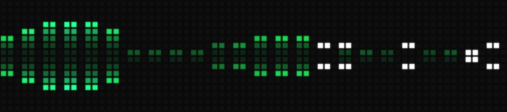</a> | [**Audio Visualizer**](audio-visualizer/) by [@maxswinkels](https://github.com/maxswinkels) [gallery page](https://maxswinkels.github.io/busybar-apps/apps/audio-visualizer/) *zero-install* | Live microphone spectrum on the LEDs: five render styles (bars, mirror, segments, dots, wave) and colour themes. | `audio` `effect` `music` |
|  | [**Bad Apple**](bad-apple/) by [@codynhanpham](https://github.com/codynhanpham) [gallery page](https://maxswinkels.github.io/busybar-apps/apps/bad-apple/) *zero-install* | It has a screen? It can play Bad Apple. And yes, with audio, too! | `animation` `meme` `music` `effect` |
| <a href="buienradar-alarm/">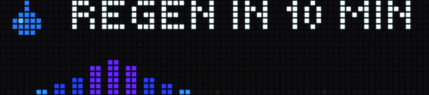</a> | [**Buienradar Alarm**](buienradar-alarm/) by [@maxswinkels](https://github.com/maxswinkels) [gallery page](https://maxswinkels.github.io/busybar-apps/apps/buienradar-alarm/) *zero-install* | Dutch rain alarm that takes the screen only when rain is coming. Shows minutes until rain or until dry, plus a 2-hour Buienradar intensity timeline colored from drizzle to downpour. | `weather` `info` |
|  | [**Busy Codex**](busy-codex/) by [@wowlocal](https://github.com/wowlocal) [gallery page](https://maxswinkels.github.io/busybar-apps/apps/busy-codex/) *zero-install* | Live Codex task status, account limits and weekly progress, with a reasoning effort dial and START-button Fast mode control for Codex Desktop and a native-control CLI fork. | `ai` `monitor` `info` `animation` |
|  | [**Busy Defaults**](busy-defaults/) by [@LuisWollenschneider](https://github.com/LuisWollenschneider) [gallery page](https://maxswinkels.github.io/busybar-apps/apps/busy-defaults/) *zero-install* | Activates a built-in BUSY Bar mode and releases it on exit. Themes: busy, keep_out, dnd, meeting, on_call, lunch, back_soon, booked, flow, chill_time, on_air, coding, low_social_battery. | `utility` `info` |
| <a href="busybar-codex/">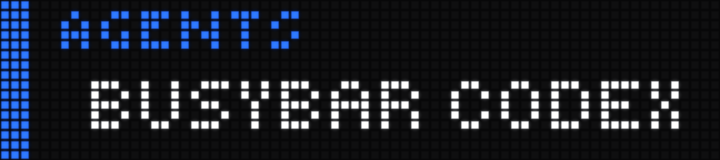</a> | [**BusyBar Codex**](busybar-codex/) by [@kylewhirl](https://github.com/kylewhirl) [gallery page](https://maxswinkels.github.io/busybar-apps/apps/busybar-codex/) *zero-install* | Tactile Codex controller with live task status, actions, navigation, reasoning control, and push-to-talk dictation. | `monitor` `productivity` `ai` `controller` |
| <a href="busybar-pinball/">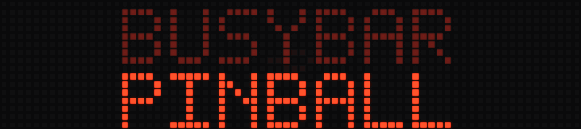</a> | [**BusyBar Pinball**](busybar-pinball/) by [@robynhub](https://github.com/robynhub) [gallery page](https://maxswinkels.github.io/busybar-apps/apps/busybar-pinball/) *zero-install* | A colorful 90s-style pinball DMD attract mode with scores, jackpots, bonus multipliers, racing animations, Extra Ball, and Insert Coin sequences. | `pinball` `retro` `animation` `ambient` |
|  | [**BusyBar-Custom-Scroll**](busybar-custom-scroll/) by [@daninsc](https://github.com/daninsc) [gallery page](https://maxswinkels.github.io/busybar-apps/apps/busybar-custom-scroll/) | Continuous scrolling ticker with network-synced date/time, weather, moon phase, NOAA tides, and season-aware sports scores. City, tide station, and teams are configurable via config.json. | `info` `clock` `weather` `monitor` |
| <a href="busybar-calendar/">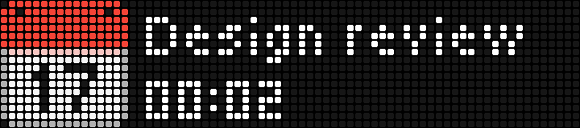</a> | [**CalDAV Calendar**](busybar-calendar/) by [@kurok](https://github.com/kurok) [gallery page](https://maxswinkels.github.io/busybar-apps/apps/busybar-calendar/) | Meeting reminders with a countdown, then a red BUSY while it runs, from any CalDAV or ICS calendar - iCloud, Fastmail, Nextcloud, PrivateEmail or an Outlook link. | `calendar` `caldav` `ics` `productivity` `info` |
| <a href="character/">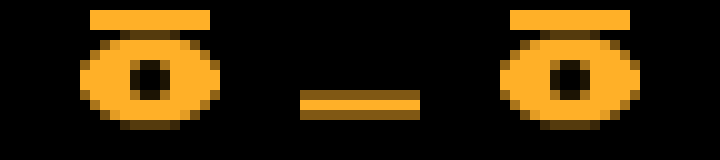</a> | [**Character**](character/) by [@antoninsmetana](https://github.com/antoninsmetana) [gallery page](https://maxswinkels.github.io/busybar-apps/apps/character/) | A parametric face that reacts to your machine - CPU load, live Claude Code turns, battery, keyboard idle - and to the bar's buttons and wheel. It blinks, glances around, sweats, and takes a punch. | `effect` `animation` |
| <a href="claude-approve/">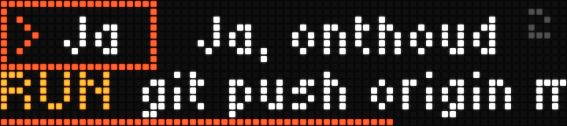</a> | [**Claude Approve**](claude-approve/) by [@maxswinkels](https://github.com/maxswinkels) [gallery page](https://maxswinkels.github.io/busybar-apps/apps/claude-approve/) *zero-install* | Answer Claude Code prompts from the bar - permissions, plan approval and multiple-choice questions - with the wheel and START button. | `ai` `controller` `productivity` `monitor` |
| <a href="claude-limits/">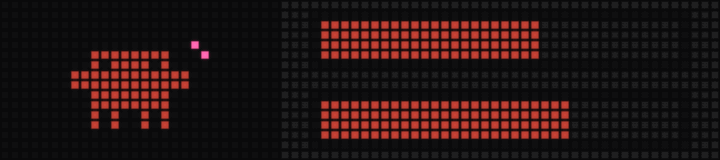</a> | [**Claude Limits**](claude-limits/) by [@rbhbokka](https://github.com/rbhbokka) [gallery page](https://maxswinkels.github.io/busybar-apps/apps/claude-limits/) *zero-install* | Live Claude Code usage — 5-hour session and weekly limit bars with time to reset, an animated Clawd mascot, and a session-activity readout. | `monitor` `info` `ai` |
|  | [**Clock**](clock/) by [@maxswinkels](https://github.com/maxswinkels) [gallery page](https://maxswinkels.github.io/busybar-apps/apps/clock/) *zero-install* | Customizable Clock widget - customizable, big time, refreshed every second. | `clock` `time` `customizable` |
| <a href="countdown/">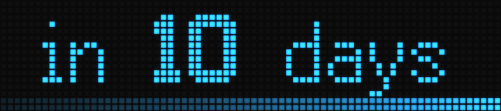</a> | [**Countdown**](countdown/) by [@LuisWollenschneider](https://github.com/LuisWollenschneider) [gallery page](https://maxswinkels.github.io/busybar-apps/apps/countdown/) *zero-install* | Animated countdown to any moment, coarse when far off and mm:ss in the final hour, with amber/red thresholds and a red count-up once it passes. | `clock` `countdown` `info` |
|  | [**Counter**](counter/) by [@LuisWollenschneider](https://github.com/LuisWollenschneider) [gallery page](https://maxswinkels.github.io/busybar-apps/apps/counter/) *zero-install* | A simple counter app with custom formatting and caching. For queue management, or just counting things. | `utility` `counter` `info` |
| <a href="crypto-ticker/">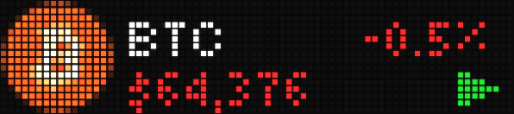</a> | [**Crypto Ticker**](crypto-ticker/) by [@itsTylerIRL](https://github.com/itsTylerIRL) [gallery page](https://maxswinkels.github.io/busybar-apps/apps/crypto-ticker/) | Live crypto prices on the LED matrix -- logo, price and 24h change per coin, with a top-button pause and wheel scrubbing. Prices from CoinGecko. | `crypto` `finance` `info` |
|  | [**DVD Bounce**](dvd-bounce/) by [@EzraMoussa](https://github.com/EzraMoussa) [gallery page](https://maxswinkels.github.io/busybar-apps/apps/dvd-bounce/) *zero-install* | The classic bouncing DVD screensaver. A colorful pixel logo ricochets around the bar, changes color at every bounce, and occasionally hits the perfect corner. | `animation` `screensaver` `retro` |
| <a href="flightradar/">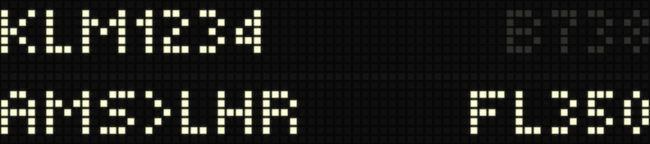</a> | [**Flightradar**](flightradar/) by [@maxswinkels](https://github.com/maxswinkels) [gallery page](https://maxswinkels.github.io/busybar-apps/apps/flightradar/) *zero-install* | Quiet until a plane flies over, then a split-flap board shows its callsign, aircraft type, route, and live altitude and speed, from live ADS-B data. | `info` `monitor` |
|  | [**FRT Ticker**](frt-ticker/) by [@robynhub](https://github.com/robynhub) [gallery page](https://maxswinkels.github.io/busybar-apps/apps/frt-ticker/) *zero-install* | Live Internet routing statistics including IPv4/IPv6 prefixes, FRT size, RPKI status, AS-path length, top origin ASes, and IPv6 adoption. | `network` `internet` `bgp` `info` |
| <a href="gcal-glance/">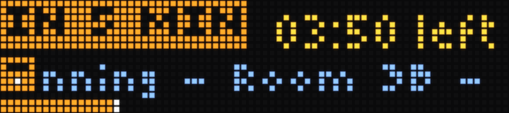</a> | [**GCal Glance**](gcal-glance/) by [@Kilo59](https://github.com/Kilo59) [gallery page](https://maxswinkels.github.io/busybar-apps/apps/gcal-glance/) | Ambient Google Calendar display for BUSY Bar — at-a-glance meeting countdowns, alerts, and live schedule awareness. | `google-calendar` `calendar` `productivity` `info` |
| <a href="github-actions/">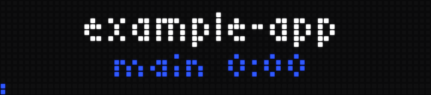</a> | [**GitHub Actions**](github-actions/) by [@maxswinkels](https://github.com/maxswinkels) [gallery page](https://maxswinkels.github.io/busybar-apps/apps/github-actions/) *zero-install* | Live GitHub Actions status for the repos you pick: a progress bar while a run works, confetti when it passes, and a red hold naming the job that failed. | `monitor` `utility` `info` |
| <a href="github-graph/">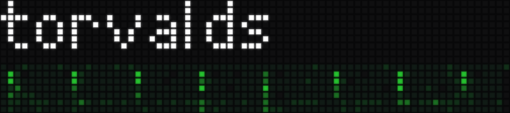</a> | [**GitHub Graph**](github-graph/) by [@maxswinkels](https://github.com/maxswinkels) [gallery page](https://maxswinkels.github.io/busybar-apps/apps/github-graph/) *zero-install* | Your GitHub contribution graph on the bar. Username in a 7px pixel font above 72 weeks of history, one pixel per day. Long names scroll, and there are green, orange, and blue themes. | `info` `monitor` |
|  | [**GitHub PRs**](github-prs/) by [@JayMcConnon](https://github.com/JayMcConnon) [gallery page](https://maxswinkels.github.io/busybar-apps/apps/github-prs/) *zero-install* | Your open pull requests at a glance. Counts for ready, running, failing and waiting, a scrolling line of what needs you, and a banner when one is ready to merge, fails or gets merged. | `github` `monitor` `info` |
| <a href="github-repo/">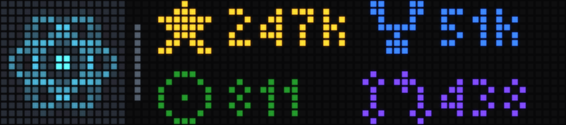</a> | [**GitHub Repo**](github-repo/) by [@LuisWollenschneider](https://github.com/LuisWollenschneider) [gallery page](https://maxswinkels.github.io/busybar-apps/apps/github-repo/) | Display a single Github-Repo with stars, forks, open issues and open pull requests. Counts flash when they change. | `info` `monitor` `github` |
| <a href="home-assistant/">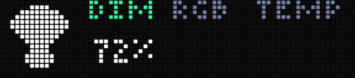</a> | [**Home Assistant**](home-assistant/) by [@kylewhirl](https://github.com/kylewhirl) [gallery page](https://maxswinkels.github.io/busybar-apps/apps/home-assistant/) | Browse and control Home Assistant lights with the BUSY Bar dial, Select, and Start controls. | `home` `monitor` `info` |
| <a href="iss-alert/">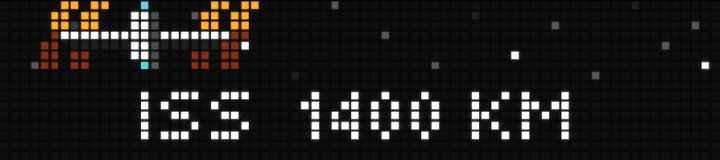</a> | [**ISS Alert**](iss-alert/) by [@maxswinkels](https://github.com/maxswinkels) [gallery page](https://maxswinkels.github.io/busybar-apps/apps/iss-alert/) *zero-install* | Stays quiet until the space station passes near you. Then a pseudo 3D ISS slides across a twinkling starfield, hangs overhead with live distance, and drifts off the far edge as it leaves. | `info` `animation` |
|  | [**Lava Lamp**](lava-lamp/) by [@robynhub](https://github.com/robynhub) [gallery page](https://maxswinkels.github.io/busybar-apps/apps/lava-lamp/) *zero-install* | A procedural lava lamp for BUSY Bar with flowing metaballs, surface tension, natural merging and splitting, and highly customizable motion and colors. | `ambient` `animation` `lava-lamp` `pixel-art` |
| <a href="lunar-phases/">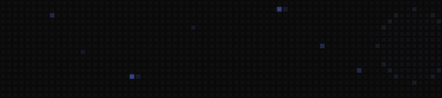</a> | [**Lunar Phases**](lunar-phases/) by [@robynhub](https://github.com/robynhub) [gallery page](https://maxswinkels.github.io/busybar-apps/apps/lunar-phases/) | Animated lunar phases for BUSY Bar, showing the current Moon phase with multilingual labels, automatic replay, and button-triggered animation. | `moon` `astronomy` `ambient` |
| <a href="mac-monitor/">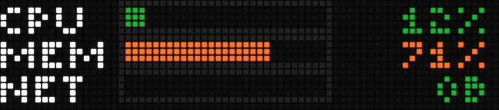</a> | [**Mac Monitor**](mac-monitor/) by [@maxswinkels](https://github.com/maxswinkels) [gallery page](https://maxswinkels.github.io/busybar-apps/apps/mac-monitor/) *zero-install* | Mac system monitor - CPU, memory and network as live bars. | `monitor` `system` |
|  | [**Magic 8-Ball**](magic-8-ball/) by [@robynhub](https://github.com/robynhub) [gallery page](https://maxswinkels.github.io/busybar-apps/apps/magic-8-ball/) | Interactive Magic 8-Ball for BUSY Bar with animated rolling, multilingual answers, button control, and optional auto-roll. | `game` `interactive` `fun` |
|  | [**Matrix Digital Rain**](matrix-digital-rain/) by [@robynhub](https://github.com/robynhub) [gallery page](https://maxswinkels.github.io/busybar-apps/apps/matrix-digital-rain/) *zero-install* | Matrix-style digital rain animation for BUSY Bar, with configurable character size, speed, density, and color theme. | `animation` `ambient` `matrix` |
| <a href="media-player/">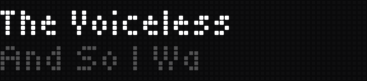</a> | [**Media Player**](media-player/) by [@robynhub](https://github.com/robynhub) [gallery page](https://maxswinkels.github.io/busybar-apps/apps/media-player/) | Displays system-wide Now Playing information and provides media controls for BUSY Bar. | `media` `music` `now-playing` `controls` |
| <a href="media-player-karaoke/">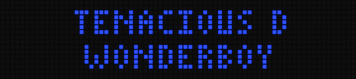</a> | [**Media Player Karaoke**](media-player-karaoke/) by [@robynhub](https://github.com/robynhub) [gallery page](https://maxswinkels.github.io/busybar-apps/apps/media-player-karaoke/) | Shows synced song lyrics on BUSY Bar with karaoke highlighting, playback controls, scrolling metadata, and optional two-line lyric mode. | `media` `music` `karaoke` `lyrics` `now-playing` `controls` |
|  | [**Moneybird Invoice Paid**](moneybird-invoice-paid/) by [@maxswinkels](https://github.com/maxswinkels) [gallery page](https://maxswinkels.github.io/busybar-apps/apps/moneybird-invoice-paid/) *zero-install* | Watches your Moneybird administration and celebrates every newly paid invoice with a coin rain, an odometer count-up of the amount and a cash-register sound. | `monitor` `info` `effect` |
| <a href="nyan-cat/">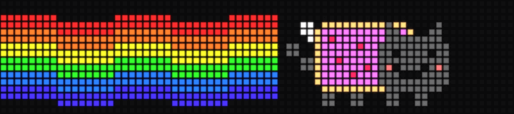</a> | [**Nyan Cat**](nyan-cat/) by [@maxswinkels](https://github.com/maxswinkels) [gallery page](https://maxswinkels.github.io/busybar-apps/apps/nyan-cat/) *zero-install* | The classic nyan cat - pop-tart cat with a rainbow trail and twinkling stars. | `animation` `effect` |
| <a href="nyc-subway/">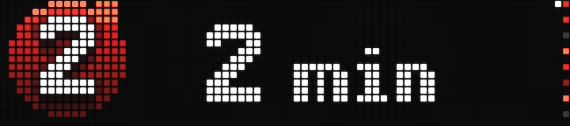</a> | [**NYC Subway**](nyc-subway/) by [@Pranav-Karra-3301](https://github.com/Pranav-Karra-3301) [gallery page](https://maxswinkels.github.io/busybar-apps/apps/nyc-subway/) | Live next-train departures for any NYC subway station — pick station, direction and lines; MTA route bullets, minutes to train, departure flash. GTFS-realtime, no API key. | `transit` `info` `time` |
| <a href="pixel-aquarium/">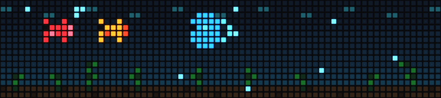</a> | [**Pixel Aquarium**](pixel-aquarium/) by [@robynhub](https://github.com/robynhub) [gallery page](https://maxswinkels.github.io/busybar-apps/apps/pixel-aquarium/) *zero-install* | A relaxing procedural pixel aquarium for BUSY Bar, with colorful fish, bubbles, swaying seaweed, and a smooth day/night cycle. | `ambient` `animation` `aquarium` `pixel-art` |
| <a href="pixel-fire/">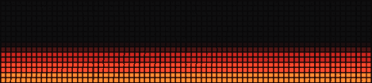</a> | [**Pixel Fire**](pixel-fire/) by [@maxswinkels](https://github.com/maxswinkels) [gallery page](https://maxswinkels.github.io/busybar-apps/apps/pixel-fire/) *zero-install* | Demoscene pixel effects - fire, matrix rain, and plasma. | `effect` `animation` |
| <a href="pixel-runner/">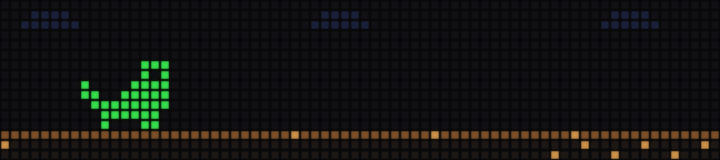</a> | [**Pixel Runner**](pixel-runner/) by [@antoninsmetana](https://github.com/antoninsmetana) [gallery page](https://maxswinkels.github.io/busybar-apps/apps/pixel-runner/) | An endless jump-and-duck runner on the 72x16 panel. START jumps, OK or BACK ducks; cacti and birds come at you, the world speeds up, day turns to night. Left alone it plays itself. | `game` `animation` |
| <a href="pollen-alarm/">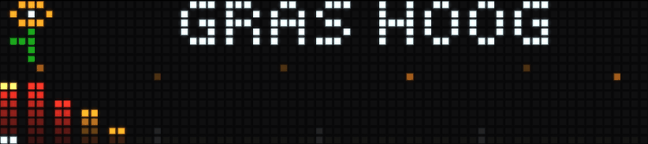</a> | [**Pollen Alarm**](pollen-alarm/) by [@maxswinkels](https://github.com/maxswinkels) [gallery page](https://maxswinkels.github.io/busybar-apps/apps/pollen-alarm/) *zero-install* | Hay fever alarm for Europe. Quiet while pollen is low, then the worst species with a 24 hour intensity timeline, a marker on the announced hour and drifting pollen specks. Data from Open-Meteo. | `weather` `info` |
| <a href="revenue-bar/">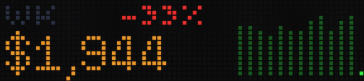</a> | [**Revenue Bar**](revenue-bar/) by [@alexharston](https://github.com/alexharston) [gallery page](https://maxswinkels.github.io/busybar-apps/apps/revenue-bar/) *zero-install* | Stripe + Paddle net revenue on your bar. Day, week, month and year to date with trend sparklines and same-point deltas. | `business` `monitor` `info` |
| <a href="rss-scroller/">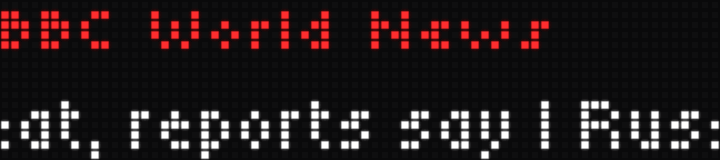</a> | [**RSS Feed Scroller**](rss-scroller/) by [@robynhub](https://github.com/robynhub) [gallery page](https://maxswinkels.github.io/busybar-apps/apps/rss-scroller/) *zero-install* | Fetch an RSS feed and show it | `news` `rss` `info` |
| <a href="slot-machine/">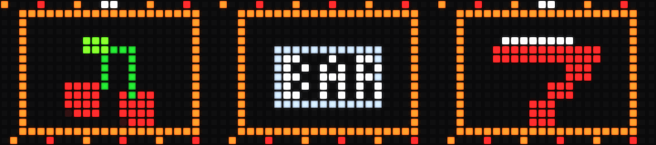</a> | [**Slot Machine**](slot-machine/) by [@robynhub](https://github.com/robynhub) [gallery page](https://maxswinkels.github.io/busybar-apps/apps/slot-machine/) | Animated classic fruit-machine slot for BUSY Bar with automatic or START-button spins, cumulative score, win effects, jackpot animations, and sound. | `game` `arcade` `retro` `slot-machine` |
| <a href="sonos-now-playing/">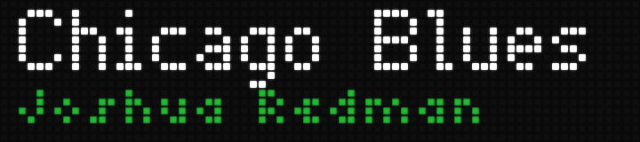</a> | [**Sonos Now Playing**](sonos-now-playing/) by [@bret@thewortmans.org](https://github.com/bret@thewortmans.org) [gallery page](https://maxswinkels.github.io/busybar-apps/apps/sonos-now-playing/) | Shows the currently playing Sonos track and artist on the BUSY Bar. Auto-discovers speakers; clears the display when playback stops. | `music` `audio` `monitor` |
| <a href="spotify-now-playing/">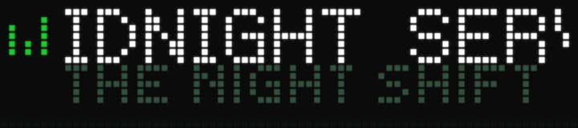</a> | [**Spotify Now Playing**](spotify-now-playing/) by [@kylewhirl](https://github.com/kylewhirl) [gallery page](https://maxswinkels.github.io/busybar-apps/apps/spotify-now-playing/) | Shows Spotify now playing with progress, play/pause, skip, and volume controls from the BUSY Bar. | `music` `info` `monitor` |
| <a href="text-display/">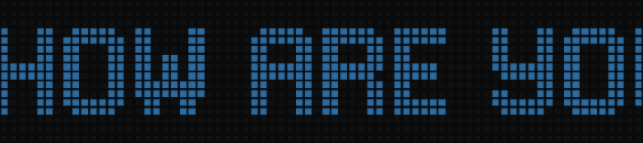</a> | [**Text Display**](text-display/) by [@LuisWollenschneider](https://github.com/LuisWollenschneider) [gallery page](https://maxswinkels.github.io/busybar-apps/apps/text-display/) *zero-install* | Show some text. That's it! | `info` `text` |
| <a href="tide-clock/">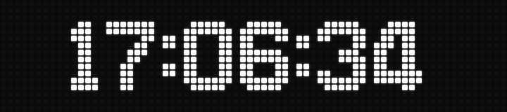</a> | [**Tide Clock**](tide-clock/) by [@daninsc](https://github.com/daninsc) [gallery page](https://maxswinkels.github.io/busybar-apps/apps/tide-clock/) *zero-install* | Alternates between a big clock and the next tide (high/low, height, time) for any NOAA station. | `clock` `info` |
| <a href="uptime-bar/">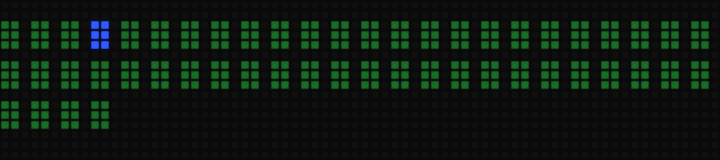</a> | [**Uptime Bar**](uptime-bar/) by [@maxswinkels](https://github.com/maxswinkels) [gallery page](https://maxswinkels.github.io/busybar-apps/apps/uptime-bar/) *zero-install* | Connects to your Uptime Kuma instance and draws every monitor as one cell in a wall of pixels: dim green while all is well, then a red takeover naming the site and its downtime when one fails. | `monitor` `info` `utility` |
| <a href="waves/">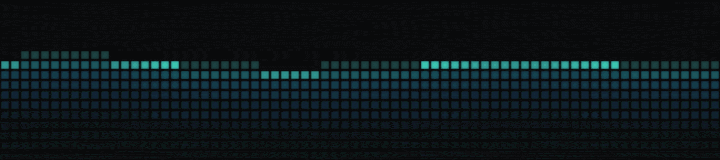</a> | [**Waves Simulator**](waves/) by [@robynhub](https://github.com/robynhub) [gallery page](https://maxswinkels.github.io/busybar-apps/apps/waves/) *zero-install* | A lava-lamp-like ocean animation for BUSY Bar, with colorful moving waves, smooth transitions from calm to stormy seas, realistic gradients, foam, reflections, sound and configurable speed. | `weather` `screensaver` `sound` `info` |
| <a href="weather-forecast/">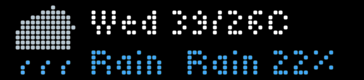</a> | [**Weather Forecast**](weather-forecast/) by [@robynhub](https://github.com/robynhub) [gallery page](https://maxswinkels.github.io/busybar-apps/apps/weather-forecast/) *zero-install* | Current weather and multi-day forecasts for BUSY Bar, with configurable location, units, and language. | `weather` `info` |
| <a href="workout-timer/">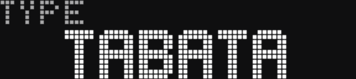</a> | [**Workout Timer**](workout-timer/) by [@teunbruijnen](https://github.com/teunbruijnen) [gallery page](https://maxswinkels.github.io/busybar-apps/apps/workout-timer/) *zero-install* | Interval timer for Tabata, fixed-rest (work at your own pace) and fixed-work (rest as long as you need) workouts, set up on the bar, with BUSY timer sounds and a recap. | `timer` `fitness` `workout` |
